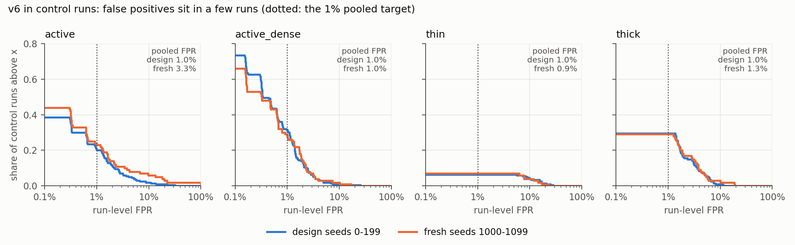

# Final detector (v4 / v6): seed-level uncertainty and fresh-seed validation

Detection v6 is the final detector (v4 where the cluster channel is off). Two checks of how far
its numbers can be trusted. Owner label, pooled ratios, 95% percentile bootstrap over seeds
(2,000 resamples).

| File | Content |
|---|---|
| `seed_ci.py` | bootstrap CIs from a data root's `detection_v6/results.csv` (`python seed_ci.py <out dir> <data root> <suffix>`) |
| `seed_ci.csv` | the 200 design seeds (0-199), data root `$WASH_V8_DATA` |
| `seed_ci_heldout.csv` | fresh seeds 1000-1099, data root `$WASH_V8_HELDOUT` |
| `heldout.py` | generates the v8 sweeps for new seeds and scores them with the thresholds, null and applicability table **copied unchanged** from the 200-seed run (nothing recalibrated); refuses seeds below 200 |

## 1. Fresh-seed validation (seeds 1000-1099, 14,000 runs, thresholds frozen)

**Recall** (`adversary` sweep, pooled over executions; design seeds -> fresh seeds):

| Background | gap | v4 | v6 |
|---|---|---|---|
| active | 0 | 0.300 -> 0.293 | 0.822 -> 0.826 |
| active | 5 | 0.054 -> 0.049 | 0.501 -> 0.500 |
| active_dense | 0 | 0.249 -> 0.260 | 0.731 -> 0.740 |
| active_dense | 5 | 0.050 -> 0.055 | 0.342 -> 0.363 |
| thick | 0 / 5 | 0.677 -> 0.677 / 0.468 -> 0.457 | same (channel off) |
| thin | 0 / 5 | 0.654 -> 0.647 / 0.513 -> 0.506 | same (channel off) |

The largest change over the 36 v6 recall cells (gap, pipeline, edge order, lam_wash) is 0.022; the
median is 0.006. Fresh-seed estimates fall outside the design-seed CI in several cells, but by
at most 0.02: the design-seed CIs are narrow (each pools 100+ cells) and ignore that the fresh
seeds are a new sample. Read the agreement as "within 0.02", not as a pass/fail on the CI.

**`honest` sweep, active family, v6 recall** (every cell within 0.03 of the design seeds):
`active` evasive .854 -> .870, block .948 -> .951, interleaved D=8 .813 -> .809;
`active_mu4` .708 -> .709, .788 -> .782, .653 -> .669.

**False positives.**

- *In wash runs* (the FPR that matters for a wash group's neighbours): unchanged, active v6
  0.8% -> 0.9%, active_dense 0.4% -> 0.4%, thin 1.5% -> 1.3%, thick 1.9% -> 1.9%.
- *In control runs the pooled FPR is not 1% out of sample.* The thresholds are calibrated at 1% on the
  design controls, so 1% there holds by construction. On 100 fresh controls: active **3.3%**
  (95% CI 1.1-6.3%), active_dense 1.0%, thick 1.3%, thin 0.9%.
- The active excess is five control runs (s1001, s1070, s1085, s1093, s1099) in which the
  **closure channel** flags 20-100% of the run's trades (e.g. 298 of 298). Honest closures
  saturate in some active runs; v6's cluster channel flags 0 trades in them. The design seeds
  have the same tail, only milder (largest run: 107 of ~316). So the calibrated 1% is an average
  over a heavy-tailed run-level distribution; with 100 controls, its sampling error is large.
  This is the known weakness of closure in active markets (detection v2), not a new one.

## 2. Run-level FPR of the control runs (`control_fpr.py` -> `control_fpr.png`, `control_fpr.csv`)

The pooled 1% is an average over a very uneven run-level distribution (v6, owner label):

| | active design / fresh | active_dense | thin | thick |
|---|---|---|---|---|
| median run FPR | 0 / 0 | 0.3% / 0.3% | 0 / 0 | 0 / 0 |
| runs with any FP | 39% / 44% | 74% / 66% | 7% / 7% | 30% / 29% |
| runs with FPR > 10% | 2% / 6% | 1% / 2% | 4% / 4% | 1% / 2% |
| share of FP in the top 5 runs | 44% / 78% | 28% / 41% | 61% / 83% | 22% / 49% |
| pooled FPR without the top 5 runs | 0.56% / 0.77% | 0.74% / 0.64% | 0.39% / 0.15% | 0.80% / 0.70% |

- Most control runs have no false positive at all; a handful carry most of them. In fresh
  active, 6 of 100 runs exceed 10%, and the top 5 hold 78% of all false positives. Without them,
  the pooled FPR is 0.77%, below the target.
- Pooling all 300 active control runs (design + fresh) gives about 1.8%. The 1% target is right on
  average only in-sample; the honest statement is "about 1-2%, dominated by rare runs".
- The heavy runs come from the closure channel: closure alone, at its own 1% threshold, has
  1,052 false positives in fresh active, v6 has 1,037, and the cluster channel alone has 2.
  (`fp_alone_*` columns: each channel used alone; they overlap, so they are not an attribution.)
- The curves for design and fresh seeds coincide except for that tail, in every background.

## 3. Seed-level CIs on the design seeds

`seed_ci.csv` has recall (by background, gap, pipeline, edge order, lam_wash; honest-sweep cells)
and FPR (control runs, wash runs) with CIs for v4 and v6. Typical half-width for pooled recall:
0.005-0.01; for the control FPR: 0.3-0.5 percentage points (design seeds), 1-3 points (100 fresh controls).
